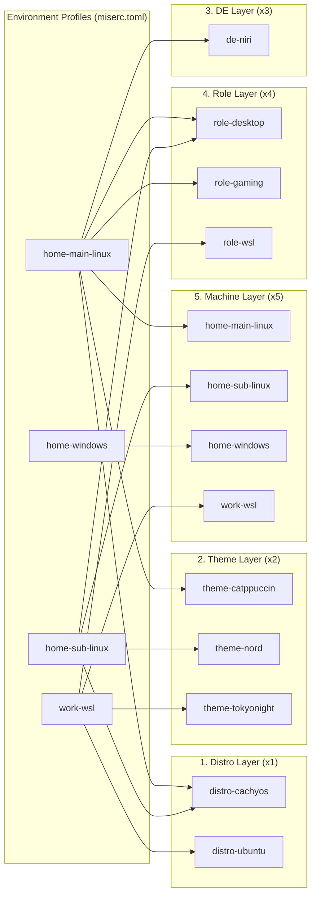

# Dotfiles

## Architecture & 5-Layer Module System

This repository uses [`mise`](https://mise.jdx.dev/) (`env_conf_d` + `[env_sets]` in [`miserc.toml`](miserc.toml)) to compose environments from **5 orthogonal module layers**:

1. **Distro Layer (`distro-*`, prefix `x1`)**: Distribution family, package manager (`pacman`/`aur`, `apt`, `dnf`, etc.), repositories/PPAs, base system packages, services, and firewall rules.
2. **Theme Layer (`theme-*`, prefix `x2`)**: Color scheme settings and theme dotfiles across CLI/GUI tools (`catppuccin`, `nord`, `tokyonight`).
3. **Desktop Environment Layer (`de-*`, prefix `x3`)**: Window manager / DE dotfiles, GTK/Qt theme engines, icon/cursor sets, and DE hooks (`de-niri`). Excluded on environments where the DE is managed via GUI.
4. **Role / Purpose Layer (`role-*`, prefix `x4`)**: Workload-specific configs, packages, and environment variables (`role-desktop`, `role-gaming`, `role-wsl`).
5. **Environment-Specific Layer (`<env>`, prefix `x5`)**: Per-machine overrides and glue packages (e.g., distro + theme specific packages like `aur:catppuccin-fcitx5-git` or `pacman:fcitx5-nord`).



### Directory Layout

- [`miserc.toml`](miserc.toml): Defines `[env_sets]` mapping each environment profile to its 5-layer module list.
- [`conf.d/`](conf.d): Modular configuration fragments named `<Phase><Layer>-<category>.<module>.toml`:
  - **10s digit (Phase)**:
    - `0x-general`: General `mise` settings (`color_theme`, `system_packages.managers`)
    - `1x-dotfiles`: Declarative dotfile symlinks and shell RC blocks (`[dotfiles]`)
    - `2x-apps`: `mise` tools (`[tools]`) and OS packages (`[bootstrap.packages]`)
    - `3x-system`: Shell aliases, environment variables, systemd services, and firewall rules
    - `9x-misc`: Bootstrap hooks (`pre-packages`, `post-packages`, `post-dotfiles`, `post-tools`) and git repos
  - **1s digit (Layer)**:
    - `x0`: All environments / `unix` common base
    - `x1`: Distro layer (`distro-cachyos`, `distro-ubuntu`, future `distro-fedora`, etc.)
    - `x2`: Theme layer (`theme-catppuccin`, `theme-nord`, `theme-tokyonight`)
    - `x3`: Desktop Environment layer (`de-niri`)
    - `x4`: Role layer (`role-desktop`, `role-gaming`, `role-wsl`)
    - `x5`: Machine-specific layer (`home-main-linux`, `home-sub-linux`, `home-windows`, `work-wsl`)
- [`common/`](common): OS/theme-agnostic application configs (`nvim`, `fish`, `powershell`, `zed/keymap.json`, `zed/tasks.json`, `fontconfig`, `paru`, `heroic/config.json`, `topgrade.toml`, and helper scripts in [`common/scripts/`](common/scripts)).
- [`de-niri/`](de-niri): Desktop environment dotfiles for `niri` + `dms` + GTK/Qt/`dux-icons`/Colloid cursors/`nwg-look` (`de-niri` module).
- [`themes/`](themes): Color scheme modules (`bat`, `bottom`, `cava`, `eza`, `fcitx5`, `fish`, `ghostty`, `heroic`, `radian`, `starship`, `tabby`, `yazi`, `zed/settings.json`):
  - [`themes/catppuccin/`](themes/catppuccin): Catppuccin Macchiato (including Limine bootloader & Linux TTY themes)
  - [`themes/nord/`](themes/nord): Nord
  - [`themes/tokyonight/`](themes/tokyonight): Tokyo Night Night
- [`home-windows/`](home-windows): Windows-specific configuration (`Win11Debloat`).

---

## Environments

| Profile                                       | Composed Modules (`[env_sets]`)                                                                   | Distro / DE              | Theme                | Installer                    |
| :-------------------------------------------- | :------------------------------------------------------------------------------------------------ | :----------------------- | :------------------- | :--------------------------- |
| **`home-main-linux`** _(alias: `home-linux`)_ | `distro-cachyos`, `theme-catppuccin`, `de-niri`, `role-desktop`, `role-gaming`, `home-main-linux` | CachyOS (`niri` + `dms`) | Catppuccin Macchiato | [`install.sh`](install.sh)   |
| **`home-sub-linux`** _(alias: `sub-linux`)_   | `distro-cachyos`, `theme-nord`, `role-desktop`, `home-sub-linux`                                  | CachyOS (GUI-managed DE) | Nord                 | [`install.sh`](install.sh)   |
| **`home-windows`**                            | `home-windows`                                                                                    | Windows 11 Home          | Catppuccin Macchiato | [`install.ps1`](install.ps1) |
| **`work-wsl`**                                | `distro-ubuntu`, `theme-tokyonight`, `role-wsl`, `work-wsl`                                       | WSL2 (Ubuntu)            | Tokyo Night Night    | [`install.sh`](install.sh)   |

> [!NOTE]
> Neovim ([`common/.config/nvim/`](common/.config/nvim)) uses a lightweight, zero-Mason modular architecture powered by Neovim 0.12 native `vim.lsp.config`, `blink.cmp`, `snacks.picker`, and `conform.nvim`. All language servers and formatters are managed exclusively via `mise`, and the colorscheme (`catppuccin-macchiato`, `nord`, or `tokyonight-night`) switches automatically based on `MISE_ENV`.

---

## Extending the Configuration (Examples)

### Adding a New Distro Family (e.g., Fedora / `dnf` or Arch / WSL Distro)

1. Create `x1` distro fragments in [`conf.d/`](conf.d):
   - `01-general.distro-fedora.toml` (`system_packages.managers = ["dnf"]`)
   - `21-apps.distro-fedora.toml` (`[bootstrap.packages]` with `"dnf:..."`)
   - `31-system.distro-fedora.toml` / `91-misc.distro-fedora.toml`
2. Compose a profile in [`miserc.toml`](miserc.toml) combining the new distro with any existing theme, DE, and role layers:

   ```toml
   # Example: Fedora desktop with Nord theme
   home-fedora-linux = ["distro-fedora", "theme-nord", "role-desktop", "home-fedora-linux"]
   # Example: Arch-based WSL with Tokyo Night theme
   work-arch-wsl = ["distro-cachyos", "theme-tokyonight", "role-wsl", "work-arch-wsl"]
   ```
3. Add a `setup_distro_<name>()` function and menu entry in [`install.sh`](install.sh).

---

## Installation

Python is left to the system by default so `uv`-managed tools use the
platform's Python and its available build dependencies. Projects that need a
mise-managed Python can opt in from their `mise.toml`:

```toml
[settings]
disable_tools = []

[tools]
python = "3.13"
```

### Linux or WSL

Run the Bash installer from a terminal:

```bash
bash -c "$(curl -fsSL https://raw.githubusercontent.com/skyblue-jpn/.dotfiles/main/install.sh)"
```

Select `home-main-linux`, `home-sub-linux`, or `work-wsl` when prompted. The installer
installs the platform prerequisites, writes `/etc/mise/miserc.toml`, and
runs the complete bootstrap. CachyOS profiles (`home-main-linux` and `home-sub-linux`)
use nftables explicitly so the firewall phase does not depend on backend
auto-detection.

NTFS mounts are machine-specific and are intentionally not part of mise
bootstrap. Configure them after setup with [`common/scripts/mount-filesystem.sh`](common/scripts/mount-filesystem.sh):

```bash
# Proton-compatible game partition
${HOME}/.config/mise/common/scripts/mount-filesystem.sh \
  --mode game --interactive

# Other storage partitions
${HOME}/.config/mise/common/scripts/mount-filesystem.sh \
  --mode storage --interactive
```

The `game` mode uses the Proton-compatible `umask=000` profile and defaults to
`/media/gamedisk`. The `storage` mode defaults to `/media/storage` and uses
`umask=022`; both modes accept the same partition, UID/GID, filesystem, and
fstab options. The interactive mode accepts multiple partition and mount-point
pairs and adds UUID-based entries to `/etc/fstab`.

A shared NTFS volume must not be mounted read-write while Windows Fast Startup
or hibernation is enabled. NTFS Steam
libraries shared with Windows are unsupported by Valve and can cause games to
crash or lose data; keep Proton `compatdata` on a Linux filesystem as
recommended by the [Proton NTFS guidance](https://github.com/ValveSoftware/Proton/wiki/Using-a-NTFS-disk-with-Linux-and-Windows).

### Windows

Run the following in PowerShell. The script installs or relaunches into
PowerShell 7 when necessary, installs Git and mise through winget, and runs
the complete `home-windows` bootstrap:

```powershell
$installer = Join-Path $env:TEMP 'dotfiles-install.ps1'
irm https://raw.githubusercontent.com/skyblue-jpn/.dotfiles/main/install.ps1 -OutFile $installer
& $installer
```

Alternatively, download `install.ps1` and run it locally:

```powershell
.\install.ps1
```
